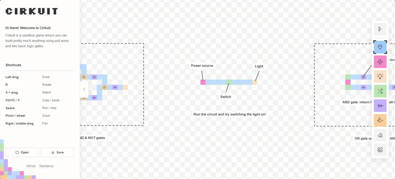
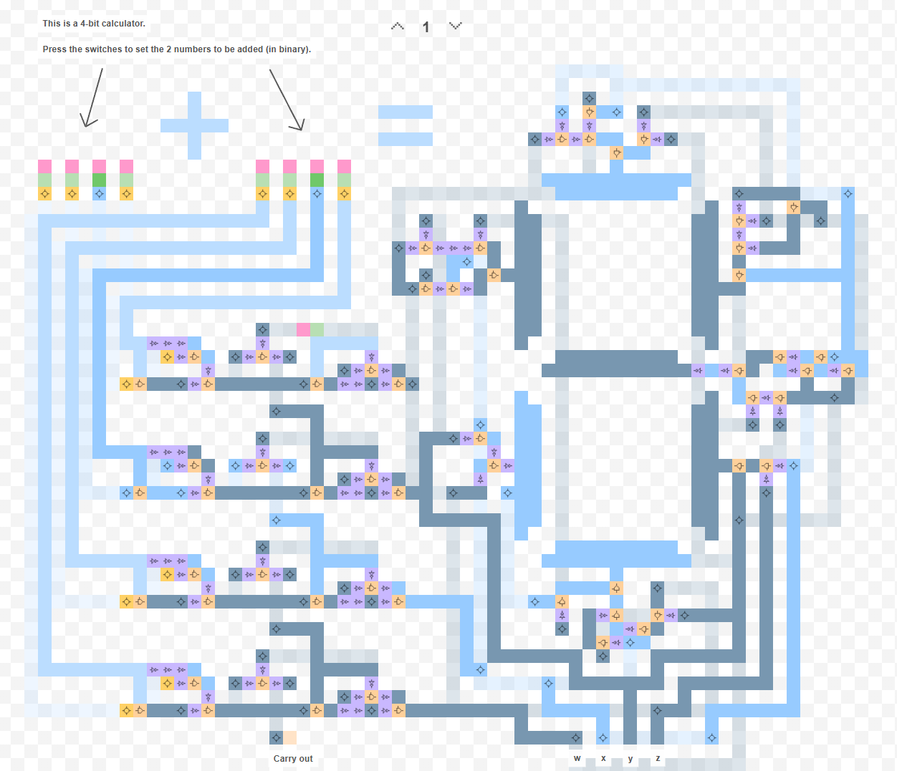
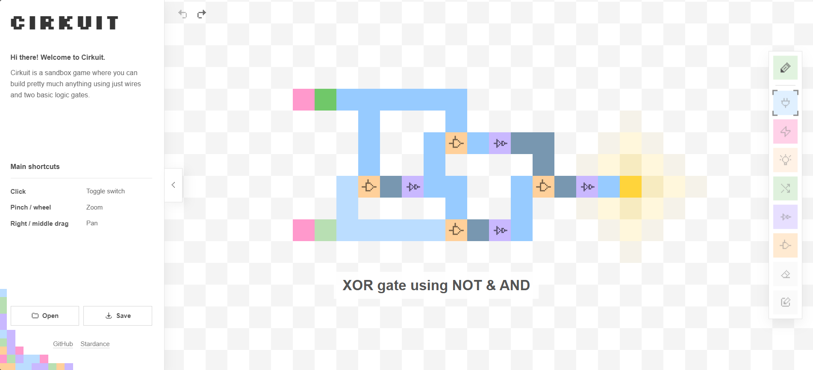

# Cirkuit

A pixel-art circuit sandbox (that's it). Place components on the grid, connect them, and build whatever you want!



[Try Cirkuit online](https://nafo44.github.io/Cirkuit/)

> AI was used as a source of information during the development of this
> project, and sometimes to generate code snippets for specific implementation problems.
> All generated code was reviewed. I used AI a bit more for my last devlogs because
> I was running out of time before the end of Stardance.
> The concept, UI/UX, and assets were created entirely by me.

## Why I made this

Well, I'm studying Electronics and Industrial Computing at university, so this theme is literally a perfect fit for me.

I also know Stardance brings together a lot of software developers and hardware makers, so I wanted to build something that speaks to both. Just circuits and logic gates. What could go wrong?

## Recommended setup

It is recommended to use a laptop or desktop computer with a mouse to use Cirkuit, although use with a laptop touchpad is also supported.

## Controls

> [!NOTE]
> Shortcuts are also shown in-game.

### Edit mode:

- **Left drag**: Draw
- **R**: Rotate
- **S + drag**: Select
- **Ctrl+C / Ctrl+V**: Copy / paste
- **Space**: Run / stop
- **Pinch / wheel**: Zoom
- **Right / middle drag**: Pan

### Simulation mode:

- **Click**: Toggle switch
- **Space**: Run / stop
- **Pinch / wheel**: Zoom
- **Right / middle drag**: Pan

## Features

After the engine itself, my main goal was to optimize the user experience. So that's why Cirkuit only has essential features:

- Project import/export: projects are saved as .cirkuit files.
- 2 modes: editing and simulation. Press the Space bar or the button at the top of the sidebar to start the simulation.
- 2 layers: yes! It's very usefull since you can't cross wires. Use the "via" component to link wires on two different layers together.
- Basic components: power source, wire, lamp, switch, NOT gate, AND gate, clock, and 1-bit memory (simplified D flip-flop)
- Annotation: Cirkuit has three tools for documenting your projects: label, line, and rectangle.
- Selection: you can select, copy/paste, and move groups of pixels, making it much easier to modify your circuit!
- Probe tool: it highlight equipotential wires, for debugging and simplifying your circuits!
- Modules: Is your circuit getting too big? Create modules! A module is basically like an integrated circuit that you can reuse over and over. You define its pins, footprint, and name. This feature is mainly for more advanced users!
- Eraser: it erases lol

## Capabilities

You can build pretty much anything you can imagine.

> [!NOTE]
> Two demo circuits are available to try live in-game!

### A calculator



It's basically just 4x 1-bit full adders wired to a 4-bit 7-segment decoder.

In the demo project, you'll find the same circuit, but using modules for the 1-bit full adder. Instead of repeating the same circuit 4 times, I just created a 5x3 module and reused it.

### XOR gate



Pretty basic one! It's made from four NAND gates (AND followed by NOT).

### Your next build?

No pressure :D

## Development

Node.js 24 and npm are recommended.

```shell
npm ci
npm run dev
```

Run all checks before committing:

```shell
npm run format:check
npm run lint
npm run test
npm run build
```

## How it works

The editor, circuit model, and simulation engine are kept separate. This makes it possible to change one part without having to rewrite everything else.

### From pixels to electrical nets

Every component placed in the editor is stored in the circuit layout with its ID, type, position, and rotation. The actual behavior of the component lives in a separate registry, which defines its ports, outputs, and state.

When the simulation starts, the grid gets compiled into a netlist. The compiler handles things like rotating component ports, connecting ports that are next to each other and facing each other, and grouping connected conductive parts into nets.

So basically, if you draw a row of connected wire pixels, the compiler turns all of them into one shared electrical net.

### Signal simulation

Each net can be `floating`, `low`, `high`, or `conflict`. The simulation engine propagates the signals until everything settles into a stable state.

Switches are also handled on simulation ticks, so toggling one applies the change atomically on the next tick. If the circuit contains an unstable loop, the engine detects it and reports it instead of getting stuck and freezing the editor (which can happen when working on complex circuits),

### Modularity and project files

Components own their ports and simulation logic, as mentioned above. This keeps the rest of the system fairly dumb: adding a new component doesn't require changing the netlist compiler or the simulation engine.

Projects are stored as `.cirkuit` JSON files. Zod validates documents when they are imported and exported, so malformed projects or projects modified manually can't crash the editor at runtime.

Things like unknown component types, duplicate IDs, overlapping components, or components placed outside the grid are rejected.
